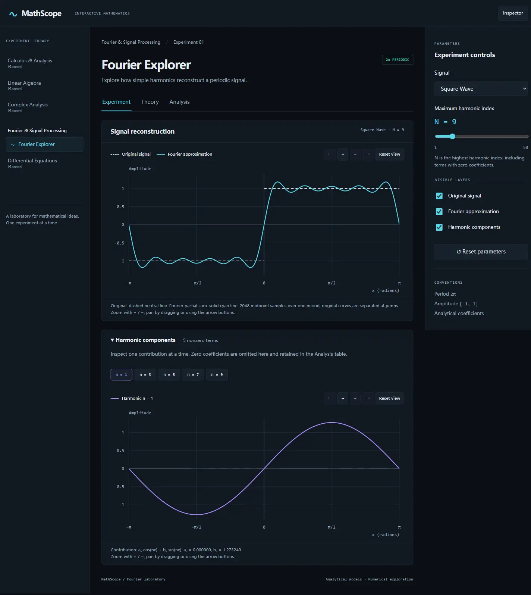
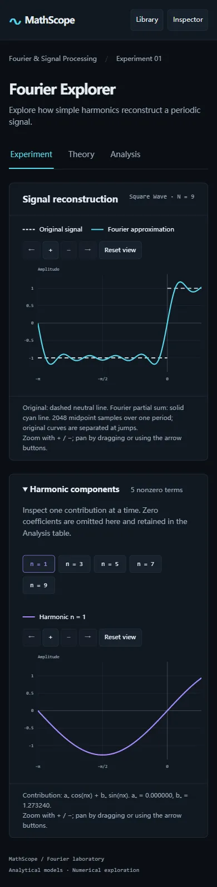

# MathScope — Fourier Explorer

An interactive mathematics laboratory built with React, TypeScript and Vite. Version **0.1.0** implements the Fourier Explorer MVP. Release verification and deployment status are recorded in [the execution log](docs/execution-log.md).



## Explore

- Select Square, Sawtooth or Triangle Wave, all with period 2π and amplitude in [−1, 1].
- Change the highest harmonic index N from 1 to 50 (default 9).
- Compare the dashed original signal with the solid Fourier approximation. Original curves are split at jumps.
- Inspect each nonzero harmonic independently; expand/collapse the harmonic section or hide it with the Inspector.
- Zoom, pan and reset each plot. Use the labeled buttons with a keyboard, or drag with a mouse after zooming. On narrow screens, scroll within the plot horizontally.
- Read signal definitions, analytical coefficients, symmetry and convergence in Theory.
- Inspect every coefficient (including zeros), sampled RMSE, sampled maximum error and local Gibbs behavior in Analysis.
- Keep configuration when switching tabs; reset restores the initial square-wave experiment and all visible layers.

The dark Scientific Laboratory interface supports desktop columns, a collapsible Inspector, and small-screen modal Library/Inspector drawers. Arrow keys navigate workspace tabs. Escape closes drawers and returns focus. Formula output includes MathML. Color is supplemented by labels and line styles. Reduced motion is respected.

<details><summary>Mobile screenshot</summary>



</details>

## Run locally

Use **Node.js 22.12+ on the 22.x line, or Node.js 24+ on a supported even-numbered release**, with npm. Verification used Node 24.18.0. The committed lockfile pins the dependency tree.

```bash
npm ci
npm run dev
```

Open the URL printed by Vite. No backend, API keys, account or external font service is needed to run locally.

```bash
npm test          # Type-check application/tests and run Vitest once
npm run test:watch
npm run lint     # Oxlint; warnings fail the command
npm run build    # TypeScript project build and Vite static bundle
npm run preview  # Serve dist locally; not a production hosting service
```

## Mathematical contract

The [Fourier specification](docs/mathematics/fourier.md) is authoritative. N is the maximum harmonic **index**, not the count of nonzero terms. The sum includes a₀/2 and indices 1–N. Coefficients are analytical; displayed error metrics are numerical estimates.

Global errors use exactly **M=2048** uniform midpoints on (−π, π). RMSE approximates normalized L² error; the sampled maximum is not the continuous supremum. Displayed metrics are rounded to six decimals. Chart zoom never changes the global error grid. Gibbs views use a separately labeled local grid. The 8.949% overshoot statement is a theoretical limiting value, not a measured finite-N value. Triangle is continuous and has no jump-discontinuity Gibbs overshoot.

The core throws explicit errors for invalid IDs, nonfinite inputs and invalid resource bounds. Its API accepts N=0–50, 1–65536 samples, intervals spanning at most two periods, and coordinates within one million periods. Large coordinates are rejected to avoid implying reliable floating-point phase reduction. The UI uses the narrower approved defaults. Errors in computation or lazy content loading produce a visible recovery message.

## Source organization

| Directory | Responsibility |
| --- | --- |
| `src/core/` | Pure TypeScript signal models, coefficients, sums, sampling and errors; no React or DOM |
| `src/experiments/fourier/` | Experiment configuration, orchestration, theory and analysis |
| `src/visualization/` | Data adapters and replaceable generic SVG renderer; no Fourier calculations |
| `src/app/` | Application layout and navigation |
| `src/components/ui/` | Shared tabs, drawers, formulas and error boundary |
| `src/styles/` | Global styles and design tokens |
| `tests/` | Mathematical, architecture, adapter and presentation tests |

See [architecture](docs/architecture.md), [renderer evaluation](docs/renderer-decision.md), [implementation plan](docs/implementation-plan.md) and [milestone evidence](docs/execution-log.md). Runtime dependencies added for the MVP: KaTeX. Development dependencies added: Vitest and KaTeX declarations. No charting or state-management library is required.

## Release and deployment

`npm run build` produces static assets in `dist/`. Any static host serving the root URL can host these assets. No server-side runtime is required. For a subdirectory deployment, configure Vite's base path and the favicon URL before building; the current release targets an origin root.

The Sites manifest at `.openai/hosting.json` records the assigned project and `dist` output directory. Publishing requires synchronizing an exact source commit, packaging its build output, saving that version, and verifying deployment status. Do not treat the expected Site URL or a successful local preview as proof of deployment. See the execution log for the actual release result.

## Known limits

- Three predefined signals only; no arbitrary expressions, FFT, 3D rendering, export, accounts or persisted sessions.
- Configuration survives tab changes, but reload resets it; plot view and harmonic selection may reset when their panel unmounts.
- One harmonic is inspected at a time. Plots use a fixed amplitude range of ±1.4 and horizontal zoom up to 16× within the sampled domain.
- Zoom magnifies existing samples; it does not resample. High-resolution local Gibbs plots are generated separately.
- Browser QA covers Chromium desktop and emulated 320/390 px mobile and 1024 px tablet layouts. Physical devices, Firefox/Safari and screen-reader assistive technologies have not been independently tested.
- Native SVG performance was validated for the supported maximum N=50, not unbounded signal sizes. No claim of full WCAG certification is made.

Future mathematics categories remain visibly marked Planned.
